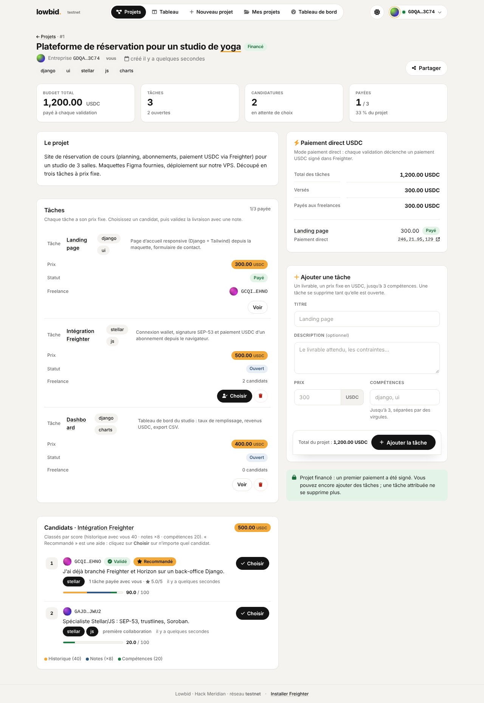
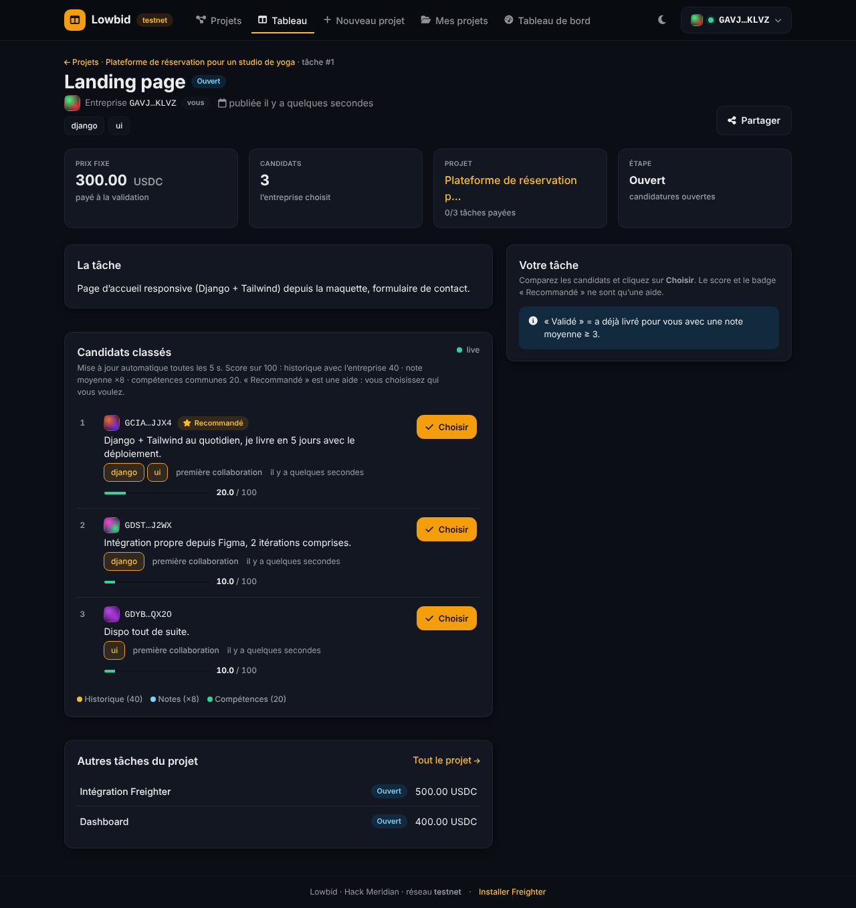
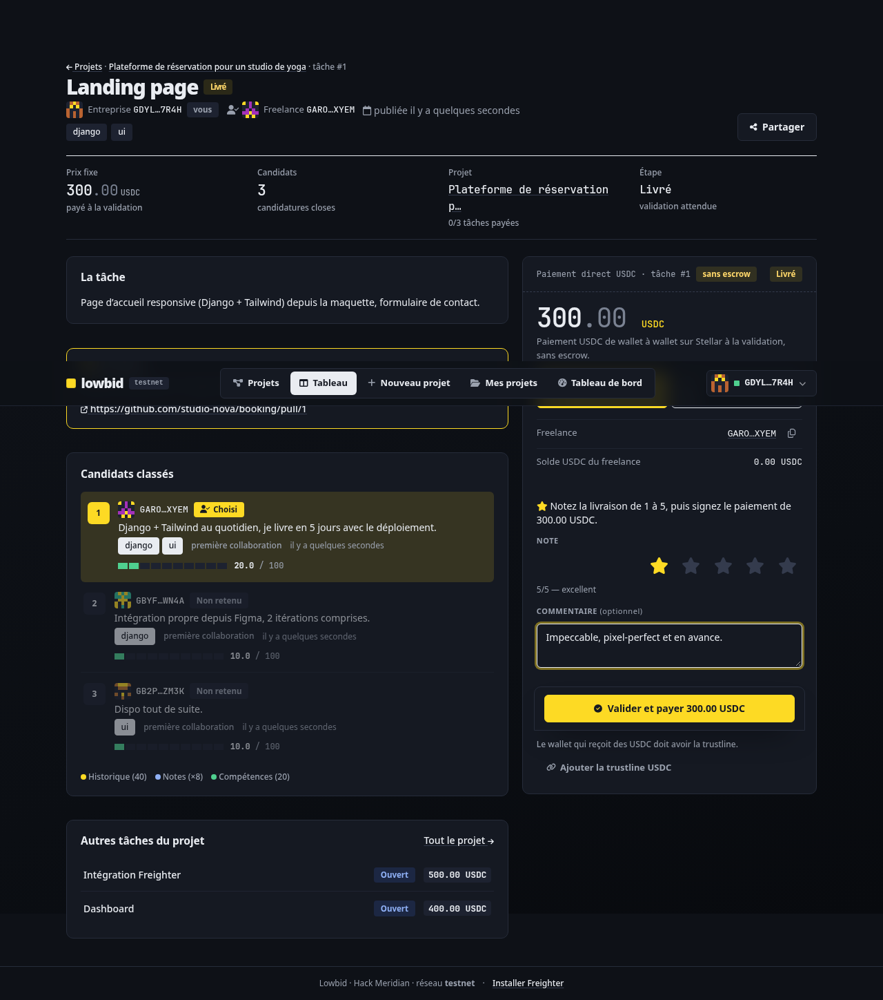
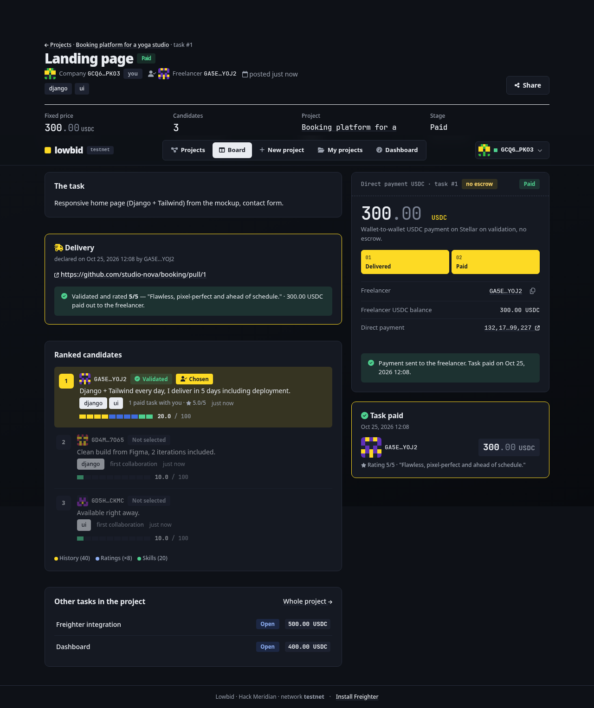
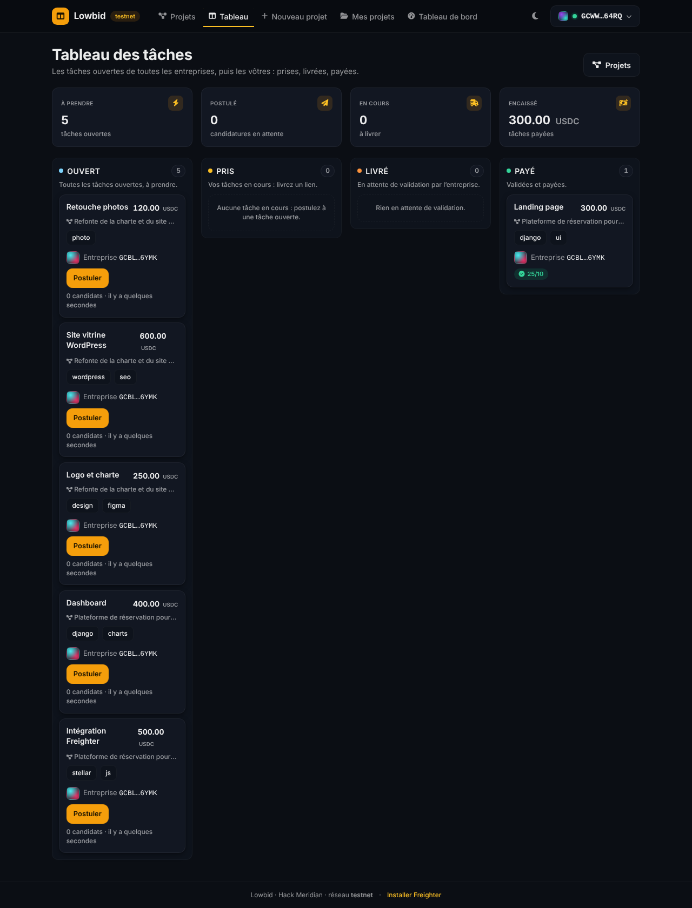
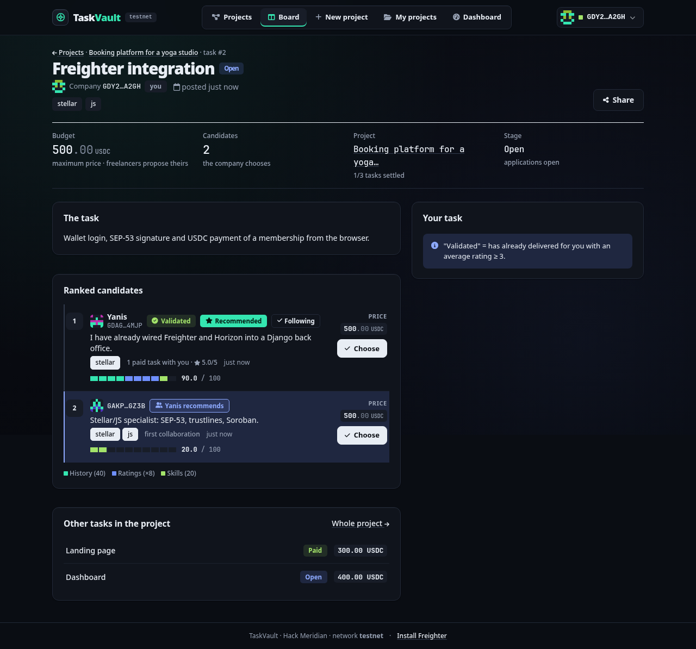

<div align="center">

# TaskVault

### Fixed prices. Earned trust. Guaranteed payment.

**A task board for freelancers on Stellar: one big project, split into tasks, each one paid in USDC from its own escrow.**

[](https://hackmeridian.com)
[](#04--track-stellar-composed)
[](https://stellar.expert/explorer/testnet)
[](https://www.djangoproject.com/)
[](#tests)
[](#license)

🌐 **Landing page:** [taskvault.art](https://taskvault.art) · 🎬 **Pitch video (3 min):** [youtu.be/Eao0bqmBHD4](https://youtu.be/Eao0bqmBHD4) · 📑 **Deck:** [docs/TaskVault-deck.pdf](docs/TaskVault-deck.pdf)

</div>


> **In one sentence.** A company splits its project into tasks, freelancers name their price, each task's money is locked on Stellar *before* the work starts and released to the freelancer's own wallet the moment the company approves.

---

# Part 1 · The product

## The problem

Freelancers get paid late. Sometimes never.
Companies that split a project between several freelancers juggle quotes, invoices and strangers, one person at a time.
And the platforms in between take **10 to 20 %** and **hold the money** until their payout cycle.

**TaskVault fixes both sides.**

## 01 · One big project, many experts

A big project, split into tasks. Each freelancer picks one and names a price.

| Task | Budget | Expert | Agreed price |
|------|--------|--------|--------------|
| Landing page | up to 300 | Léa | **280 USDC** |
| Freighter integration | up to 500 | Yanis | **480 USDC** |
| Dashboard | up to 400 | Nora | **400 USDC** |

1. **Pick the task you want.** The kanban lists every open task of every company.
2. **Propose a price ≤ budget.** Your price, your message, your skills.
3. **The score ranks, price × 0.** A simple, explainable score (history with this company, ratings, skills). The price never enters it: no race to the bottom.
4. **The company chooses.** The score is a hint, never a verdict.

Once chosen, *your* price is the task's price: it is what the escrow locks and what you are paid. The budget stays visible as « up to … » beside it.

## 02 · Sponsorship

> No reviews → no missions → still no reviews.

A recognised freelancer **sponsors** a newcomer. The loop breaks.

Follow the people you work with often. A sponsor lends their trust, so a beginner with no history can still land a first mission:

```
 L  Léa                      New account
    Front-end dev, first mission on TaskVault.

    ★ Yanis recommends
    “Worked with her twice. Clean, fast, reliable.”
```

**One hop only.** Only the wallets *you* follow count, so a ring of fake accounts shows nothing. The badge always names someone (« Yanis recommends »), sits next to the score and never changes it.

## 03 · Security at the core

**Nobody gets scammed, on either side.**

| | |
|---|---|
| 🔑 **No account, no password** | Sign a SEP-53 message in Freighter. Unique, expires in 5 minutes. Nothing to steal. |
| 🛡️ **A deposit protects freelancers** | The company locks a deposit before its project is listed. A ghost listing forfeits it to a public guarantee fund. |
| 🔒 **Money locked before work** | One escrow per task, funded once the freelancer is chosen. Every move is signed in your own wallet, never by us. |
| 🧾 **Anti-cheat** | Each signed transaction must match the planned payment; replays are refused. A fingerprint of the delivery goes on chain. |
| 🔗 **Verified links** | A freelancer's link shows its real domain and a warning when the domain is unknown. |
| ⚖️ **Disputes** | A seven-day review window: silence pays nobody. An arbiter settles on chain and can split the money, e.g. 70 % freelancer, 30 % company. |

We hold no key to your pay.

## 04 · Track Stellar Composed

**7 Stellar building blocks, one flow.** Each block does one job; TaskVault wires them into a single payment flow.

| Block | Job in TaskVault |
|-------|------------------|
| **Freighter** | Identity + signature: it's your account. |
| **Trustless Work** | One vault per task: lock, deliver, validate, release, dispute. |
| **Soroban** | The smart contracts where the vaults live. |
| **USDC · Circle** | A stable dollar to pay, no volatility. |
| **Horizon** | Live balances, trustlines, payments. |
| **Stellar SDK** | Build and send the transactions. |
| **stellar.expert** | Every transaction public and verifiable. |

## 05 · The money path

Four signatures, from deposit to payout.

```
 01 · COMPANY            02 · FREELANCER         03 · COMPANY             04 · FREELANCER
 Deposit                 Deliver                 Validate                 Paid
 Chooses the freelancer, The link is recorded    Rates the work 1 to 5,   USDC in the wallet.
 funds the task's vault. on chain.               releases.
                                      ~5 s from validation to the wallet, for a fraction of a cent
```

No wire. No thirty days. No platform holding your money.

<div align="center">

**TaskVault. You name your price. The money is vaulted. The work gets paid.**

</div>

---

# Part 2 · How it works

## The flow, end to end

```
   COMPANY                          TASKVAULT (Django)                     STELLAR (testnet)
   -------                          ------------------                     -----------------
1. Connect Freighter  ------------> signMessage check (SEP-53)  <--------- Freighter wallet
2. Create a project + tasks ------> project "Draft", tasks "Open"
   (title, budget, ≤ 3 tags)        [deposit mode: deploy + fund the
                                     publication deposit, then listed]
                        FREELANCERS
3.                      Connect Freighter, open the kanban (/taches/)
4.                      « Apply »: price + message + tags -> application scored (price ≤ budget)
5. See ranked candidates ---------> score = history + ratings + skills (price × 0), « Validated » / « Recommended »
                                    + sponsorship: « Yanis recommends » + quote, « New account », « Sponsor »
6. « Choose » one freelancer -----> task "Taken" at that price (budget kept as « up to »), the others "Not selected"
7. « Fund the project » ----------> Trustless Work API (proxied) -------> one single-release escrow
   2 signatures per task:           deploy, then fund                     PER TASK, USDC locked
8.                      « Declare the delivery » + link + fingerprint ---> milestone marked done
                        (1 signature)                                       (link + hash = on-chain evidence)
9. « Validate + rate » (1–5) -----> Rating saved, then 2 signatures:
                                    approve ---------------------------> milestone approved
                                    release ---------------------------> USDC to the freelancer
                                    task "Paid"  (project "Closed" once every task is paid or resolved)
```

1. The **company** connects its **Freighter** wallet (Stellar testnet). Login is a signed message, no password.
2. It creates a **project** and splits it into **tasks**, each with a title, a **budget** in USDC (the maximum price) and up to 3 skill tags. With deposits active, the project is listed only once the company has signed the deposit escrow.
3. **Freelancers** connect their own wallet. The kanban (`/taches/`) shows every open task of other companies plus their own, in four columns: Open, Taken, Delivered, Paid.
4. A freelancer **applies** with **their price** (at most the budget), a short message and their skills.
5. TaskVault ranks the candidates with a **deterministic score** (no AI). **« Validated »** = already paid by this company with an average rating ≥ 3; **« Recommended »** = best score among the pending candidates. Sponsorship badges sit beside them and never reorder the list.
6. **The company chooses** any candidate. The chosen price becomes the task's price.
7. The company clicks **« Fund the project »**: for every task with a chosen freelancer, Trustless Work deploys a **single-release escrow** (first signature) and the company funds it with the task's price (second signature).
8. The freelancer delivers a link (PR, demo, repo) and, optionally, a fingerprint (commit SHA or SHA-256). **« Declare the delivery »** marks the milestone done on chain with both as evidence.
9. The company checks the delivery, **rates it 1 to 5**, then signs **approve** and **release**. The escrow pays the freelancer's wallet and the task becomes « Paid ».

The next task gets easier: a freelancer who delivered well for a company climbs to the top of that company's next candidate list, with « Validated » and « Recommended ».

### What protects both sides

- **Fingerprint on chain.** The declared commit SHA or SHA-256 goes into the Trustless Work milestone evidence, so the delivered work cannot be swapped later.
- **Review window.** The company has `LOWBID_REVIEW_DAYS` (default 7) to validate or react. The deadline is shown to both sides and computed at read time: there is no timer or worker anywhere.
- **Change requests.** The company can send a delivery back with a message (at most `LOWBID_MAX_REVISIONS`, default 2) while the money stays locked. Every delivery and every request is kept in a public history on the task page.
- **On-chain dispute.** The company (before validating) or the freelancer (once the review window is over) freezes the escrow on chain. The arbiter wallet (`LOWBID_DISPUTE_RESOLVER`) splits it from `/litiges/` with a percentage.
- **Source revealed on payment.** The full deliverable link stays hidden from the company until the task is paid or resolved. The public preview and the fingerprint are enough to judge it.
- **Link warnings.** Every user-supplied link shows its real domain in large type, opens with `rel="noopener noreferrer nofollow ugc"` and carries « Unknown domain — open with care » outside `LOWBID_TRUSTED_LINK_HOSTS`.
- **Publication deposit.** Before a project is listed the company locks max(1 % of the budget, 5 USDC) in a project-level escrow. A ghost listing (no choice within `LOWBID_CHOICE_DAYS` once candidates applied) forfeits it to the guarantee fund shown on `/fonds/`. A closed or cancelled project gets it back. Both chains are signed by two server-held keys that never touch a task's money.
- **Reputation both ways.** Freelancers rate the company after a settled task. The public profile shows a payer profile computed only from confirmed on-chain hashes, with the badges « Reliable payer », « New account » and « Verified GitHub » (a signed public gist links a GitHub account to a wallet). None of it feeds the score.
- **Replay-proof signing.** Every signed XDR is parsed and compared to the planned operation before it is submitted. A replayed or altered transaction is refused as `tampered`.

### Sponsorship, precisely

Any wallet can **follow** another and **sponsor** it: one sponsorship per pair, a public 280-character quote (the code and URLs keep the `recommend` vocabulary). When a company looks at candidates it sees who the people *it follows* vouch for, one hop only: **« Yanis recommends »** (strong) or « Followed by Yanis » (weak), the sponsor's quote under the badges, a **« New account »** badge on every candidate without an on-chain payout, and a **« Sponsor »** button on each row. Badges also show on the kanban and project cards, the public profile (« Sponsorship » panel) and the dashboard's « In your network » feed.

## Scoring

For each application, against the company that owns the task:

```
score = 40 × [the freelancer already has at least one PAID task with this company]
      +  8 × average rating given by this company (0 without rating)
      + 20 × (common tags / task tags)                 (0 when the task has no tags)
```

Maximum 100, stored with one decimal, refreshed after every rating and every payment. Worked example, task « Freighter integration » (tags `stellar, js`): freelancer A was paid 5/5 for the landing page and applies with `stellar` → 40 + 5 × 8 + 20 × ½ = **90**; freelancer B, first collaboration, applies with `stellar, js` → 0 + 0 + 20 × 2/2 = **20**. The price is not in the formula. Details in [`docs/PRODUCT.md`](docs/PRODUCT.md).

## Why Stellar

- **USDC** on Stellar: the freelancer gets a dollar-stable payment, not a volatile token.
- **Speed and cost:** settlement in about 5 seconds, fees around 0.00001 XLM. A 300 USDC task is not eaten by fees.
- **Escrow on Soroban via Trustless Work:** each task's money is locked in a smart contract before the work starts, and released to the freelancer's own wallet when the company approves. Neither side can run away with it and the platform never holds it.
- **Freighter:** the wallet is the identity. Login and every payment step are signed by the user in their own wallet. TaskVault never holds a user's private key.
- **No bank in the loop:** no 10 to 20 % platform cut, no wire delays.

**The fallback, stated honestly.** If escrow creation fails, TaskVault switches to a direct USDC payment from the company to the freelancer (`LOWBID_PAYMENT_MODE=direct`, restart). The panels then read « Direct payment USDC » with a « no escrow » badge, the delivery is a plain declaration and « Validate and pay » ends with one payment signature. It still settles on Stellar in seconds, but nothing is locked before the work and there is no dispute. The same fallback applies when the configured asset is native XLM, which Trustless Work v1 cannot escrow.

## Stack

- **Python 3.13 · Django 5.2**, server-rendered templates, function views, no DRF. SQLite by default, PostgreSQL when `DJANGO_DB_HOST` is set. whitenoise + gunicorn in Docker.
- **Frontend:** self-hosted Tailwind v3 compiled into the repo, two hand-written CSS files, vanilla JS. Vendored: Font Awesome, `@stellar/freighter-api`, `@stellar/stellar-sdk`, anime.js (landing only). **Nothing loads from a CDN.** Dark theme only, responsive from 320 px, no horizontal scroll.
- **Stellar:** Freighter (SEP-53 login + signing), Trustless Work v1 REST (escrow), Horizon (balances, trustlines, direct payments), `stellar-sdk` on the Python side.
- **Rules live in one place:** every business rule is in an `<app>/services.py` and raises a typed error. Views map codes to HTTP, templates never decide anything. No cron, no worker, no WebSocket: every state change happens inside a request.

### Where Stellar lives in the code

| Path | What it does |
|------|--------------|
| `accounts/signing.py` | Verifies the Freighter `signMessage` login signature (SEP-53) |
| `payments/trustless_work.py` | Trustless Work v1 REST client: deploy / fund / milestone / approve / release / dispute / resolve, `send-transaction` |
| `payments/stellar.py` | The asset, the mode switch, `payment` / `changeTrust` XDR builders, signed-XDR parser, Horizon submit, balances, trustlines, stellar.expert links |
| `payments/services.py` | The flow: one `prepare_<step>` / `confirm_<step>` pair per step, role + state gates, both modes. **The state table is its docstring.** |
| `payments/deposits.py` · `signer.py` | The publication deposit: project-level escrow, refund / forfeit chains signed by two server keys |
| `payments/models.py` | `Escrow`, one per task: mode, contract id, every tx hash, status |
| `projects/services.py` · `scoring.py` | The task-board rules (the only place that decides) and the score |
| `network/services.py` · `reputation/services.py` | Sponsorship signals (one hop, 3 queries) · company ratings, payer profile, GitHub proof |
| `static/js/lowbid-wallet.js` · `lowbid-pay.js` | Freighter connection and signing · prepare → sign → send driver, chained steps, « Fund the project », trustline, live balance |

## Run it locally

Prerequisites: **Python 3.13** (3.14 auto-detected), **Node 22+** (Tailwind build + Playwright e2e, both run by a bare `make`; `make dev` needs Python only), the **Freighter** extension on **TESTNET** with a funded account.

```bash
make        # venv, npm, Chromium, .env wizard, migrate, lint + tests + Tailwind-in-sync + e2e, then runserver
# open http://localhost:8000
make seed   # demo data: 5 wallets incl. the arbiter, the pitch-state project, a draft, a food-truck project
            # with a change request and a disputed task, a cancelled project with a forfeited deposit
```

`make configure` runs the `.env` wizard again (Trustless Work key, payment mode, Stellar keys with a `g` that generates and funds them on testnet, deposit and demo wallets). `.env` is read once at startup: restart `make run` after any change. Without `TRUSTLESS_WORK_API_KEY` the app runs in direct-payment mode.

<a id="tests"></a>
**Tests.** `make test` runs the Django suite (531 tests: rules, scoring, budget vs agreed price, sponsorship, both payment modes, revisions, disputes, deposits, reputation, link safety, the demo seed; every network call mocked). `make e2e` drives the full task-board scenario in a real browser with a simulated Freighter and a fake Horizon, so the payment really signs and submits; screenshots land in `docs/screenshots/`. `make check` = lint + tests + Tailwind-in-sync, run before every commit.

## Docs

| File | What is in it |
|------|---------------|
| [`docs/PRODUCT.md`](docs/PRODUCT.md) | Product spec: personas, the flow, testable rules, the score, states of Project / Task / Application / Escrow, screens |
| [`docs/ARCHITECTURE.md`](docs/ARCHITECTURE.md) | Apps, data model, request flows, the Payments section (state table, modes, hooks, why one escrow per task) |
| [`docs/STELLAR_NOTES.md`](docs/STELLAR_NOTES.md) | Trustless Work single-release reference, why multi-release was rejected, asset configuration, Freighter, Horizon, smoke test |
| [`docs/DEMO_RUNBOOK.md`](docs/DEMO_RUNBOOK.md) | The live demo click by click: env, trustlines, seed, signatures, what to show on stellar.expert, fallback |
| [`docs/PITCH.md`](docs/PITCH.md) | Video script, deck outline, judge Q&A |
| [`docs/FRONTEND.md`](docs/FRONTEND.md) | Design system: tokens, every `ui-` component, the `window.Lowbid` JS API, responsive & a11y rules |
| [`docs/HACKATHON_DAY.md`](docs/HACKATHON_DAY.md) | Day-of checklist: setup, 5-minute smoke test, fallback, triage |
| [`CLAUDE.md`](CLAUDE.md) | Project instructions for an AI coding assistant: commands, repo map, conventions, e2e DOM contract, don'ts |

## Screenshots

Regenerated by `make shots` (direct mode against a fake Horizon), all in [`docs/screenshots/`](docs/screenshots/).

| | |
|---|---|
|  |  |
| Project page: tasks, statuses, funding panel | Ranked candidates, each with their price |
|  |  |
| Validate and rate the delivery | Task paid, hashes linked to stellar.expert |
|  |  |
| The freelancer's kanban | « Yanis recommends » on a new account |

Phone (390×844): `mobile-landing`, `mobile-liste`, `mobile-kanban`, `mobile-projet`, `mobile-tache-candidats`, `mobile-tableau-de-bord`.

## Status

- [x] Projects, tasks with a budget, priced applications, scoring, choice, delivery, rating (unit + e2e)
- [x] Sponsorship: follow / sponsor with a quote, one-hop badges, « New account » (unit + e2e)
- [x] Review window, change requests, delivery fingerprint, link warnings, on-chain dispute + arbiter desk (unit, network mocked)
- [x] Publication deposit, guarantee fund, company ratings, payer profile, GitHub proof (unit, network mocked)
- [x] Direct payment end to end in the e2e (fake Horizon: trustline, payment, explorer link)
- [ ] Escrow deploy → fund → deliver → approve → release on the live testnet (see [`docs/DEMO_RUNBOOK.md`](docs/DEMO_RUNBOOK.md) §1)

> History: v1, named Lowbid, was a reverse auction. The task board replaced it on 2026-10-25. The code keeps the `lowbid` prefix (`LOWBID_*` settings, `lowbid-*.css/js`, `window.Lowbid`). URL paths stay French (`/projets/`, `/taches/`, …); everything else is English.

## Team

**Ethan Lopin** — built solo for Hack Meridian 2026: product, design, Django, Stellar. Everything in this repo was built during the hackathon.

[github.com/elopin42/TaskVault](https://github.com/elopin42/TaskVault) · [taskvault.art](https://taskvault.art)

## License

MIT
