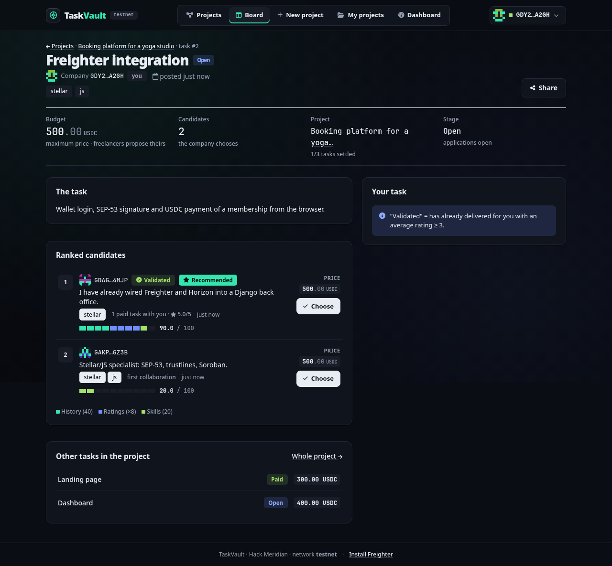

> The interface, the code and the docs are in English; only the URL paths stay French (`/projets/`, `/taches/`, …).

# TaskVault

**A company splits a project into fixed-price tasks, freelances apply, the company picks one per task, and each task is paid in USDC from its own Trustless Work escrow on Stellar.**

- **Demo video:** TODO: link
- **Pitch deck:** TODO: link
- **Hackathon:** Hack Meridian (Stellar), track **Composed**

> History: v1, then named Lowbid, was a reverse auction; the task board replaced it on 2026-10-25. The code keeps the `lowbid` prefix (`LOWBID_*` settings, `lowbid-*.css/js`, `window.Lowbid`).



---

## What it does

```
   COMPANY                          TASKVAULT (Django)                     STELLAR (testnet)
   -------                          ------------------                     -----------------
1. Connect Freighter  ------------> signMessage check (SEP-53)  <--------- Freighter wallet
2. Create a project + tasks ------> project "Draft", tasks "Open"
   (title, fixed price, ≤ 3 tags)
                        FREELANCES
3.                      Connect Freighter, open the kanban (/taches/)
4.                      « Apply »: message + tags -----> application scored (no price)
5. See ranked candidates ---------> score = history + ratings + skills, « Validated » / « Recommended »
6. « Choose » one freelance ------> task "Taken", the others "Not selected"
7. « Fund the project » ----------> Trustless Work API (proxied) -------> one single-release escrow
   2 signatures per task:           deploy, then fund                     PER TASK, USDC locked
8.                      « Declare the delivery » + link ------------------> milestone marked done
                        (1 signature)                                       (link = on-chain evidence)
9. « Validate + rate » (1–5) -----> Rating saved, then 2 signatures:
                                    approve ---------------------------> milestone approved
                                    release ---------------------------> USDC to the freelance
                                    task "Paid"
Fallback (LOWBID_PAYMENT_MODE=direct): no escrow; delivery is a declaration and step 9
(« Validate and pay ») ends with one direct payment signed in Freighter.
```

1. The **company** connects its **Freighter** wallet (Stellar testnet). Login is a signed message, no password.
2. It creates a **project** (title, description) and splits it into **tasks**, each with a title, a **fixed price** in USDC and up to 3 skill tags. Tasks can be added until the project is closed; an open task can still be deleted.
3. **Freelances** connect their own wallet. The kanban (`/taches/`) shows every open task of other companies plus the tasks assigned to them, in four columns: Open, Taken, Delivered, Paid.
4. A freelance **applies** to a task with a short message and their skills. There is no price to fight over: the price is fixed by the company.
5. TaskVault ranks the candidates with a **deterministic score** (no AI). Two badges help: **« Validated »** (already paid by this company with an average rating ≥ 3) and **« Recommended »** (the best score among the pending candidates).
6. **The company chooses** any candidate. The score is a hint, not a rule.
7. Once a freelance is chosen, the company clicks **« Fund the project »**. For every task with a chosen freelance, Trustless Work deploys a **single-release escrow** (first Freighter signature) and the company funds it with the task's price (second signature).
8. The freelance delivers: a link to the PR, the demo or the repository. In escrow mode, **« Declare the delivery »** marks the milestone done on chain with the link as evidence (one signature by the freelance).
9. The company checks the delivery, gives a **rating from 1 to 5** (« Validate and release »), and signs the approval then the **release**. The escrow pays the freelance (minus fees) and the task becomes « Paid ». When every task is paid, the project is « Closed ».

### Anti-scam guarantees

TaskVault protects both sides of a task, not just the payment:

- **Fingerprint on chain** — the freelance can declare a git commit SHA or a SHA-256 of the work; in escrow mode it goes into the Trustless Work milestone evidence, so the delivered work cannot be swapped later.
- **Review window** — the company has `LOWBID_REVIEW_DAYS` (default 7) to validate or react; the deadline is shown to both sides and computed at read time (no timer).
- **Change requests** — the company can send a delivery back with a message (at most `LOWBID_MAX_REVISIONS`, default 2) while the money stays locked; every delivery and request is kept in a public history.
- **On-chain dispute** — in escrow mode the company (before validating) or the freelance (once the review window is over, "no response") freezes the escrow on chain; an arbiter wallet (`LOWBID_DISPUTE_RESOLVER`) splits it from `/litiges/`.
- **Source revealed on payment** — the full deliverable link stays hidden from the company until the task is paid (or resolved); the public preview link and the fingerprint are enough to judge it.
- **Link warnings** — every delivery link shows its real domain in large type, opens with `rel="noopener noreferrer nofollow ugc"`, and carries "Unknown domain — open with care" outside `LOWBID_TRUSTED_LINK_HOSTS`.

Direct mode (no escrow) keeps the fingerprint, the review window, change requests and link warnings, but has no dispute: the panel says "unprotected payment".

The next task gets easier: a freelance who has delivered well for a company climbs to the top of that company's next candidate list, with « Validated » and « Recommended ».

Around the flow: a **dashboard** (`/tableau-de-bord/`, the signed-in home) lists what the wallet has to do next (candidates to choose, tasks to fund, deliveries to validate, payments to sign, tasks to deliver, empty projects), with KPIs as company and as freelance and the recent activity; every wallet has a **public profile** (`/profil/<address>/`: identicon, display name, ratings received). The project list has text search, tag chips, sorting and pagination. Dark theme only, responsive from 320 px to wide screens (stacked cards, bottom tab bar), no horizontal scroll. The landing tells the flow with a CSS 3D project cube scrubbed on scroll by anime.js.

## Why Stellar

- **USDC** on Stellar: the freelance gets a dollar-stable payment, not a volatile token.
- **Speed and cost:** settlement in about 5 seconds, fees around 0.00001 XLM, so a 300 USDC task is not eaten by fees.
- **Escrow on Soroban via Trustless Work:** each task's money is locked in a smart contract before the work starts, and released to the freelance's own wallet when the company approves. Neither side can run away with it, and the platform never holds it.
- **Freighter:** the wallet is the identity. Login and every payment step are signed by the user in their own wallet; TaskVault never holds a private key.
- **No bank in the loop:** no 10 to 20% platform cut, no wire delays.

## Scoring

For each application, against the company that owns the task:

```
score = 40 × [the freelance already has at least one PAID task with this company]
      +  8 × average rating given by this company (0 without rating)
      + 20 × (common tags / task tags)                 (0 when the task has no tags)
```

Maximum 100, stored with one decimal and refreshed after every rating and every payment. Worked example from the demo scenario, task « Freighter integration » (tags `stellar, js`): freelance A was paid 5/5 for the landing page and applies with `stellar` → 40 + 5 × 8 + 20 × ½ = **90**; freelance B, first collaboration, applies with `stellar, js` → 0 + 0 + 20 × 2/2 = **20**. Details in [`docs/PRODUCT.md`](docs/PRODUCT.md).

## Run it locally

Prerequisites: **Python 3.13** (3.14 works too, auto-detected), **Node 22+** (Tailwind build and the Playwright e2e, both run by a bare `make`; `make dev` needs Python only), the **Freighter** browser extension set to **TESTNET** with a funded account.

```bash
make        # installs everything (venv, npm, Chromium), creates .env, migrates, runs lint + 315 tests + Tailwind-in-sync + e2e, then starts the server
# open http://localhost:8000
make seed   # optional: demo data (4 wallets incl. the arbiter, the pitch-state project, a draft, a food-truck project with a change request and a dispute)
```

`.env` is read once at startup: after any change (API key, `LOWBID_PAYMENT_MODE`, asset, demo wallets…) stop the server and run `make run` again. Without `TRUSTLESS_WORK_API_KEY` the app runs in direct-payment mode.

Tests: `make test` (315 Django tests: rules, scoring, payment flow in both modes, revisions, disputes, link safety, the demo seed, network mocked) and `make e2e` (Playwright, the full task-board scenario in a real browser with a simulated Freighter and a fake Horizon, on a throwaway SQLite; screenshots land in `docs/screenshots/`; the e2e run by a bare `make` / `make verify` writes them to `data/e2e-shots/` instead). `make check` = lint + tests + Tailwind-in-sync (run it before every commit).

## Where Stellar lives in the code

| Path | What it does |
|------|--------------|
| `accounts/signing.py` | Verifies the Freighter `signMessage` login signature (SEP-53, with legacy fallbacks) |
| `payments/trustless_work.py` | Trustless Work v1 REST client: deploy / fund / milestone / approve / release, `send-transaction` |
| `payments/stellar.py` | The asset (`STELLAR_ASSET_CODE` / `STELLAR_ASSET_ISSUER`), the mode switch `payment_mode()`, `payment` / `changeTrust` XDR builders, signed-XDR parser, Horizon submit, balances, trustline checks, stellar.expert links |
| `payments/services.py` | The flow: one `prepare_<step>` / `confirm_<step>` pair per step, role + state gates, both modes, project funding view-model (state table in its docstring) |
| `payments/models.py` | `Escrow`, one per task: mode, contract id, every tx hash, status |
| `payments/views.py` + `payments/urls.py` | JSON endpoints under `/pay/`: `prepare/<task>/<step>/`, `send/<task>/<step>/`, `trustline/prepare/` + `trustline/send/`, `project/<pk>/pending.json`; `/pay/<task>/` redirects to the task page |
| `templates/payments/_escrow_panel.html` | The payment panel on the task page: stepper, the next step's button, delivery and rating forms, trustline helper, live balance, stellar.expert links |
| `templates/projects/_funding_panel.html` | The project's funding banner: total / funded / paid, every task's escrow status and hashes |
| `static/js/lowbid-wallet.js` | Freighter connection, login signature, `Lowbid.signTransaction(xdr)` |
| `static/js/lowbid-pay.js` | Prepare → Freighter sign → send driver, chained steps (deploy → fund, approve → release), « Fund the project », trustline, live balance from Horizon |

## Docs

| File | What is in it |
|------|---------------|
| [`docs/PRODUCT.md`](docs/PRODUCT.md) | Product spec: personas, the flow, testable rules R1–R24, the score with the worked example, states of Project / Task / Application / Escrow, screens |
| [`docs/ARCHITECTURE.md`](docs/ARCHITECTURE.md) | Apps, data model, request flows, the Payments section (state table, modes, hooks, why one escrow per task) |
| [`docs/STELLAR_NOTES.md`](docs/STELLAR_NOTES.md) | Trustless Work single-release reference, why multi-release was rejected, asset configuration, Freighter, Horizon, smoke test |
| [`docs/DEMO_RUNBOOK.md`](docs/DEMO_RUNBOOK.md) | The end-to-end live demo: env setup, trustlines, seed, clicks, signatures, what to show on stellar.expert, fallback mode |
| [`docs/PITCH.md`](docs/PITCH.md) | Video script, 5-slide deck, judge Q&A |
| [`docs/FRONTEND.md`](docs/FRONTEND.md) | Design system: tokens, every `ui-` component with markup, template components, `window.Lowbid` JS API, responsive & a11y rules |
| [`docs/HACKATHON_DAY.md`](docs/HACKATHON_DAY.md) | Day-of checklist: setup, 5-minute smoke test, "where do I change X", fallback, triage |
| [`CLAUDE.md`](CLAUDE.md) | Project instructions for an AI coding assistant: commands, repo map, conventions, e2e DOM contract, don'ts |

## Screenshots

Regenerated by `make e2e` / `make shots` (direct mode against a fake Horizon). Desktop: `01-landing`, `02-liste-projets`, `03-projet-entreprise`, `04-tache-candidats`, `05-tache-livree-freelance`, `06-valider-noter`, `07-tableau-kanban`, `08-tache-valide-recommande`, `09-mes-projets`, `10-tableau-de-bord`, `11-profil`, `12-tache-dark`, `13-paiement-echec`, `14-paiement-tache`, `15-financement-projet`. Phone (390×844): `mobile-landing`, `mobile-liste`, `mobile-kanban`, `mobile-projet`, `mobile-tache-candidats`, `mobile-tableau-de-bord`. All in [`docs/screenshots/`](docs/screenshots/).

## Testnet addresses

| Role | Public key | stellar.expert |
|------|------------|----------------|
| Company | | |
| Freelance A | | |
| Freelance B | | |
| Platform (dispute resolver, fee) | | |
| Escrow contract (task T1) | | |

## Track: Composed (Freighter + USDC + Trustless Work)

Three Stellar building blocks composed into one flow: **Freighter** for identity and signing, **USDC** as the unit of payment, **Trustless Work** escrow on Soroban for trustless settlement, one escrow per task.

**The fallback, stated honestly:** if escrow creation fails during the demo, TaskVault switches to a direct USDC payment (`Operation.payment`) from the company to the freelance (`LOWBID_PAYMENT_MODE=direct`, restart). The panels then read « Direct payment USDC » with a « no escrow » badge, the delivery is a plain declaration, and « Validate and pay » ends with one payment signature (« Pay the freelancer » if it has to be resumed). It still settles on Stellar in seconds, but without the escrow guarantee: nothing is locked before the work. The same fallback is used automatically when the configured asset is native XLM, which Trustless Work v1 cannot escrow.

## Status / what works

- [ ] Wallet login (Freighter signMessage) on a live testnet
- [x] Projects, fixed-price tasks, applications, scoring, choice, delivery, rating (unit + e2e tested)
- [x] Direct payment end to end in the e2e (fake Horizon: trustline, payment, explorer link)
- [ ] Escrow deploy + fund on the live testnet
- [ ] Escrow deliver + approve + release on the live testnet
- [ ] Direct payment on the live testnet

## Live checklist before demo

See [`docs/DEMO_RUNBOOK.md`](docs/DEMO_RUNBOOK.md) §1 for the full version.

1. `TRUSTLESS_WORK_API_KEY=` (testnet key from dapp.trustlesswork.com → Settings → API Keys) in `.env`; leave `LOWBID_PAYMENT_MODE=` empty (auto → escrow).
2. `LOWBID_PLATFORM_ADDRESS=G…` set to a funded testnet account **with a USDC trustline** (it is the dispute resolver and receives `LOWBID_PLATFORM_FEE`).
3. USDC trustline on the company and both freelances (Freighter → Manage assets, or « Add the USDC trustline » in the payment panel); the company holds at least the price of the task it funds (Circle faucet: 10 USDC per address per 24 h, so keep live task prices small).
4. Smoke test §6 of `docs/STELLAR_NOTES.md` once (deploy → sign → send-transaction) and keep the `contractId` as a backup screenshot.
5. If Trustless Work fails live: `LOWBID_PAYMENT_MODE=direct`, restart. A task whose escrow is already deployed keeps escrow mode.

## Built during the hackathon

Everything. Product, code, design and docs were built during Hack Meridian.

## Team

TODO: names, roles, links

## License

MIT
